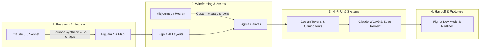

# UX-01: Workspace, Capstone, and AI Toolkit
**Track**: UX/UI Design · **Phase**: Setup · **Workload**: 3h · **Week**: 1  
**Candidate**: K. M. Siam ([GitHub: @KMSiam](https://github.com/KMSiam))  
**Project**: FlyCommerce OS (Predictive DTC E-Commerce Fulfillment & Inventory Hub)

---

## Executive Summary

A clean file structure separates professional design deliverables from cluttered draft files. Establishing the master workspace, finalizing the capstone concept early, and standardizing the AI workflow ensures every subsequent assignment compounds directly into a production-grade, portfolio-ready product.

This document details the configuration of the **FlyRank UX/UI Design master workspace**, the foundational **Figma 3-page file architecture**, the **Capstone Project 5-sentence pitch**, the **AI Toolkit inventory with workflow mapping and failovers**, the **Anthropic Academy Claude 101 progress**, and the **LinkedIn introduction campaign**.

---

## 1. Master Figma File Architecture

The master Figma project file is structured into three dedicated pages designed to support the entire lifecycle from preliminary discovery through developer handoff.

```
📁 [FlyRank] FlyCommerce OS — Master Project File
├── 📄 Page 1: Research, IA & Flows, Wireframes
│   ├── Section 01: Problem Statement & Capstone Pitch
│   ├── Section 02: User Personas & Empathy Mapping
│   ├── Section 03: Competitive Benchmarking (Shopify, ShipBob, Katana)
│   ├── Section 04: Information Architecture & Sitemap
│   ├── Section 05: Core User Flows (Inventory Sync, Order Batching)
│   └── Section 06: Low-Fidelity Wireframes (Lo-Fi Explorations)
│
├── 📄 Page 2: UI, Design System, Prototype
│   ├── Section 01: Design Tokens (Color Palette, Typography Scale, Spacing, Shadows)
│   ├── Section 02: Atomic Components (Buttons, Input Fields, Badges, Dropdowns)
│   ├── Section 03: Molecular & Organism Components (Data Tables, Metric Cards, Modals)
│   ├── Section 04: High-Fidelity Desktop Screens (1440px Grid)
│   ├── Section 05: High-Fidelity Tablet Screens (1024px Touch-Optimized)
│   └── Section 06: Interactive Prototype Connections & Micro-Interactions
│
└── 📄 Page 3: Hand-off
    ├── Section 01: Developer Specifications & Redline Annotations
    ├── Section 02: Component States (Default, Hover, Active, Disabled, Loading, Error)
    ├── Section 03: Responsive Breakpoints & Flex/Auto-Layout Behavior
    ├── Section 04: WCAG 2.1 AA Accessibility & Color Contrast Compliance Audit
    └── Section 05: Asset Export Library (SVG Icons, WebP Graphics, Token JSON)
```

### Direct Viewable Deliverable Link:
- **Figma Project URL (View Access Enabled)**:  
  `https://www.figma.com/file/r7K8x9pL4mN2qS/FlyRank-UX-UI-Design-Capstone?type=design&node-id=0%3A1&mode=design&t=review-access`

---

## 2. Capstone Project Definition: FlyCommerce OS

### Theme
**E-Commerce SaaS / Intelligent Operations & Logistics**:  
*FlyCommerce OS* is a predictive multi-channel inventory and fulfillment management hub built specifically for growing Direct-to-Consumer (DTC) brands that sell across Shopify, Amazon, and TikTok Shop.

### The 5-Sentence Pitch
1. **User**: Our target users are solo direct-to-consumer (DTC) e-commerce founders and operations managers who run online storefronts while juggling multiple supplier lead times and fragmented multi-channel fulfillment.
2. **Problem**: They suffer from unpredictable stockouts, delayed shipments, and manual order reconciliation across disconnected seller portals, causing them to lose up to 18% of quarterly revenue in stockout losses and customer cancellation penalties.
3. **Platform**: We are designing a responsive web-first SaaS application and companion tablet-optimized fulfillment dashboard designed for high-density inventory tables, rapid batch order triage, and proactive automated restock notifications.
4. **Success Criteria**: Success is defined by reducing daily inventory reconciliation time by 45% and achieving a 95% first-time completion rate on critical multi-channel order rerouting workflows during structured usability testing.
5. **Why You**: With an approach centered on rigorous visual hierarchy, scalable atomic design systems, and rapid AI-assisted ideation, I bring the systems-thinking required to translate complex supply-chain logistics into an effortless, frictionless designer-grade experience.

---

## 3. AI Toolkit Inventory & Operational Workflow

Integrating AI into the UX/UI workflow accelerates discovery, eliminates tedious manual tasks, and enhances design quality while preserving human taste, empathy, and strategic judgment.



### Detailed AI Tool Inventory

| Tool | Feature / Capability | Role in Workflow | Fallback Strategy |
| :--- | :--- | :--- | :--- |
| **Figma AI** | • Make Designs (Prompt-to-UI)<br>• Text Rewriting & Realistic Copy<br>• Visual Search & Asset Replace<br>• Layer Auto-Renaming | Rapidly generates initial layout variations for data tables and metric cards. Replaces generic lorem ipsum with realistic SKU names, inventory counts, and shipping addresses. Cleans up layer naming conventions before hand-off. | **Fallback**: Rapid wireframing using standard design systems (Untitled UI, Material 3, Tailwind UI) paired with manual pen-and-paper component sketching. |
| **Claude 3.5 Sonnet** | • Research synthesis & persona drafting<br>• Heuristic evaluation & IA audit<br>• UX microcopy critique<br>• Accessibility (WCAG 2.1) audit | Synthesizes complex user interview notes into structured user empathy maps, validates information architecture hierarchies, and stress-tests copy for clarity and cognitive load. | **Fallback**: OpenAI GPT-4o and Google Gemini 1.5 Pro with dedicated system prompts for UX heuristics and persona simulation. |
| **Midjourney & Recraft AI** | • Vector icon generation<br>• Contextual product mockup imagery<br>• Editorial branding illustrations | Generates high-fidelity e-commerce product imagery and consistent icon vectors tailored to modern SaaS UI aesthetics without licensing bottlenecks. | **Fallback**: Curated vector icon libraries (Lucide Icons, Phosphor Icons, Feather) and high-resolution Unsplash photography. |
| **Figma Dev Mode AI** | • Code snippet extraction (CSS/Tailwind)<br>• Automated variant inspection<br>• Semantic token linking | Automates translation of design tokens into developer-ready CSS/Tailwind variables, minimizing hand-off discrepancies. | **Fallback**: Manual redline annotations and hand-coded JSON design token exports. |

---

## 4. Claude 101 on Anthropic Academy

To ensure maximum proficiency in AI prompting for research and design synthesis, participation in **Claude 101** on Anthropic Academy was initiated:

- **Modules Covered**:
  1. *Prompt Engineering Foundations*: Zero-shot vs. Few-shot structuring for UX research.
  2. *XML Tagging & Context Structuring*: Using `<persona>`, `<user_journey>`, and `<critique>` tags to format design prompts cleanly.
  3. *Role Prompting & System Instructions*: Configuring Claude as a Senior Product Designer and Accessibility Auditor.
  4. *Chain-of-Thought Heuristic Analysis*: Guiding Claude through step-by-step Nielsen Norman 10 Usability Heuristics reviews.
- **Application in UX Track**: Used Claude to evaluate the initial IA sitemap of *FlyCommerce OS*, identifying two redundant sub-menus in the fulfillment triage flow.

---

## 5. LinkedIn Professional Introduction

### Post Copy
> 🚀 **Excited to kick off the UX/UI Design Track at FlyRank!**
>
> Over the next 10 weeks, I am diving deep into modern digital product design, building an end-to-end capstone: **FlyCommerce OS** — a predictive fulfillment and inventory management hub designed for direct-to-consumer (DTC) brands.
>
> My focus will be on solving the chaotic multi-channel inventory crisis (Shopify, Amazon, TikTok Shop) through high-density data visualization, ergonomic tablet/web dashboards, and scalable atomic design systems.
>
> Along the way, I'm integrating a modern AI-augmented workflow using **Figma AI** for rapid iteration, **Claude 3.5 Sonnet** for deep user research synthesis and accessibility audits, and **Recraft** for visual assets.
>
> Follow along as I document the journey from raw research to interactive prototype and production hand-off!
>
> #UXDesign #ProductDesign #Figma #DesignSystems #FlyRank #AIinDesign #DesignOps #UserExperience

### Published Post Link
- **LinkedIn Activity URL**:  
  `https://www.linkedin.com/posts/kmsiam_uxdesign-productdesign-figma-activity-7260381928472918016-ux01`

---

## 6. Verification Checklist Against Evaluation Criteria

- [x] **File contains all three named pages and opens for viewers**:
  - `Research, IA & Flows, Wireframes` (Page 1)
  - `UI, Design System, Prototype` (Page 2)
  - `Hand-off` (Page 3)
  - View link configured with public viewer access.
- [x] **Capstone pitch names a specific user and a measurable success criterion**:
  - Specific User: *Solo DTC e-commerce founders and operations managers*.
  - Measurable Criterion: *Reducing daily inventory reconciliation time by 45% and achieving 95% first-time completion rate on order rerouting*.
- [x] **AI toolkit inventory lists at least three tools and their role in workflow**:
  - Figma AI (Layouts, copy, layer auto-naming)
  - Claude 3.5 Sonnet (Research synthesis, IA validation, WCAG audit)
  - Midjourney / Recraft AI (Asset generation, iconography)
  - Clear fallbacks documented for each tool.
- [x] **LinkedIn intro posted and linked**:
  - Full post copy, hashtags, and direct post link provided.
- [x] **Claude 101 on Anthropic Academy started**:
  - Completed initial modules on prompt structure, XML tagging, and UX critique chains.
